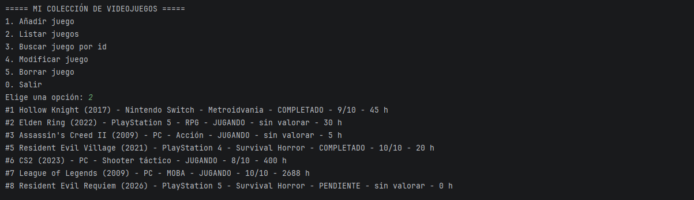
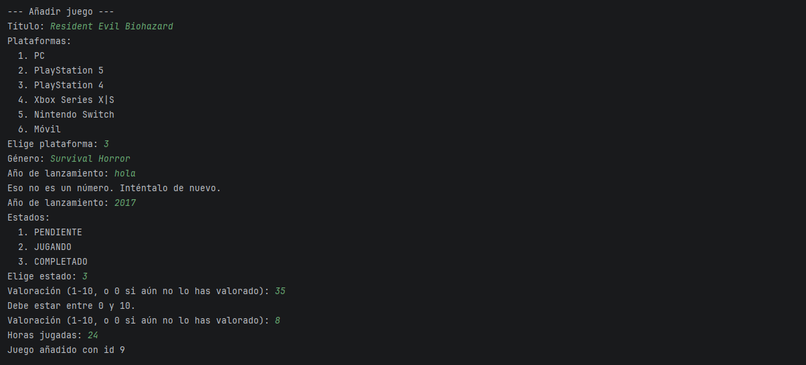
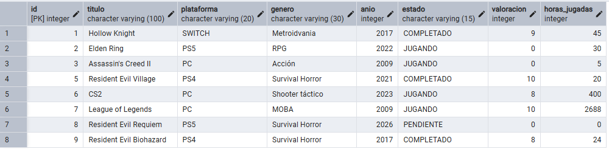

#  Colección de videojuegos

Aplicación de consola en **Java** para gestionar una colección personal de videojuegos: qué juegos tienes, en qué plataforma, si los has terminado, cuántas horas llevas y qué nota les das. Los datos se guardan en una base de datos **PostgreSQL**.

Es el primer proyecto de mi portfolio de 2º de DAM.

##  Capturas

**El menú y la colección**



**Si el usuario se equivoca, el programa avisa y vuelve a preguntar**



**Los mismos juegos guardados en PostgreSQL, vistos desde pgAdmin**



##  Qué puede hacer

- **Añadir** juegos con título, plataforma, género, año, estado, valoración y horas jugadas.
- **Listar** toda la colección.
- **Buscar** un juego por su número.
- **Modificar** cualquier dato de un juego, campo a campo.
- **Borrar** juegos, pidiendo confirmación antes.
- **Validar** lo que escribe el usuario: no deja poner una valoración de 15 ni un año imposible, y vuelve a preguntar en vez de cerrarse.

##  Tecnologías

- Java (JDK 25)
- PostgreSQL 18
- JDBC con el driver oficial de PostgreSQL
- Maven para gestionar las librerías
- Git y GitHub
- IntelliJ IDEA y pgAdmin 4

##  Cómo está organizado

El código está dividido en tres capas, y cada una tiene una sola responsabilidad:

```
src/main/java/
 ├── app/            → Main: el menú de consola (lo que ve el usuario)
 ├── modelo/         → Videojuego, Plataforma, Estado: los datos
 └── persistencia/   → dónde y cómo se guardan los datos
      ├── VideojuegoDAO           (interfaz: el "contrato")
      ├── VideojuegoDAOFichero    (guarda en un fichero CSV)
      ├── VideojuegoDAOPostgres   (guarda en PostgreSQL)
      └── ConexionBD              (abre la conexión con la base de datos)
sql/crear_tablas.sql   → script para crear la tabla
```

##  Decisiones destacadas

**Cambiar de fichero a base de datos tocando una sola línea.**
El menú no sabe dónde se guardan los juegos: solo usa la interfaz `VideojuegoDAO`. Primero el proyecto guardaba en un fichero CSV y después lo pasé a PostgreSQL cambiando una única línea en `Main`. Las dos versiones siguen en el código.

**Protección contra inyección SQL.**
Todas las consultas usan `PreparedStatement` con parámetros `?`, así que lo que escribe el usuario siempre se trata como un dato y nunca como una orden. Lo probé con títulos con apóstrofo, como *Assassin's Creed II*.

**Doble validación.**
El menú comprueba los datos al escribirlos, y además la tabla tiene restricciones `CHECK` que rechazan datos inválidos aunque lleguen por otro camino.

**La contraseña no está en el código.**
Los datos de conexión se leen de `bd.properties`, que está en el `.gitignore` y nunca se sube a GitHub. En el repositorio solo hay una plantilla sin contraseña: `bd.properties.ejemplo`.

**Pruebas con casos límite.**
Cada operación se probó con el caso que existe y con el que no (por ejemplo, buscar o borrar un juego que no está).

##  Cómo ejecutarlo

**Necesitas:** JDK 25, PostgreSQL y un IDE compatible con Maven (por ejemplo, IntelliJ IDEA).

1. Clona el repositorio:
   ```
   git clone https://github.com/sergicervera98-boop/Coleccion-videojuegos-java.git
   ```
2. En PostgreSQL, crea una base de datos llamada `coleccion` y ejecuta dentro el script `sql/crear_tablas.sql`.
3. Copia `bd.properties.ejemplo` con el nombre `bd.properties` y escribe tu contraseña de PostgreSQL.
4. Abre el proyecto en el IDE, deja que Maven descargue las dependencias y ejecuta la clase `app.Main`.

> Para usar el fichero CSV en vez de PostgreSQL, en `Main` comenta la línea de `VideojuegoDAOPostgres` y descomenta la de `VideojuegoDAOFichero`.

##  Qué he aprendido

- Programación orientada a objetos: clases, encapsulación, enums e interfaces.
- El patrón DAO para separar la lógica del programa de la forma de guardar los datos.
- Lectura y escritura de ficheros de texto en Java.
- Diseño de tablas en PostgreSQL: tipos de datos, claves primarias y restricciones.
- Acceso a bases de datos con JDBC: conexión, consultas y control de errores.
- Gestión de dependencias con Maven.
- Buenas prácticas de seguridad: consultas parametrizadas y datos sensibles fuera del repositorio.
- Control de versiones con Git y GitHub.

##  Limitaciones conocidas

- La lista de plataformas está en dos sitios: el enum `Plataforma` de Java y la restricción `CHECK` de la tabla. Para añadir una plataforma nueva hay que cambiar los dos.
- En la versión con fichero CSV, el carácter `;` rompería el formato. Por eso el menú no permite escribirlo. Con PostgreSQL este problema no existe.
- Si la base de datos no está disponible, el programa se detiene con un mensaje técnico en vez de un aviso amigable.

##  Mejoras futuras

- Interfaz gráfica.
- Estadísticas de la colección: horas totales, valoración media, juegos por plataforma.
- Filtros por plataforma, estado o género.
- Tests automáticos con JUnit.
- Mensajes de error más amigables en el menú.

##  Autor

**Sergi Cervera Cebrian** · Estudiante de 2º de Desarrollo de Aplicaciones Multiplataforma (DAM)
GitHub: [sergicervera98-boop](https://github.com/sergicervera98-boop)